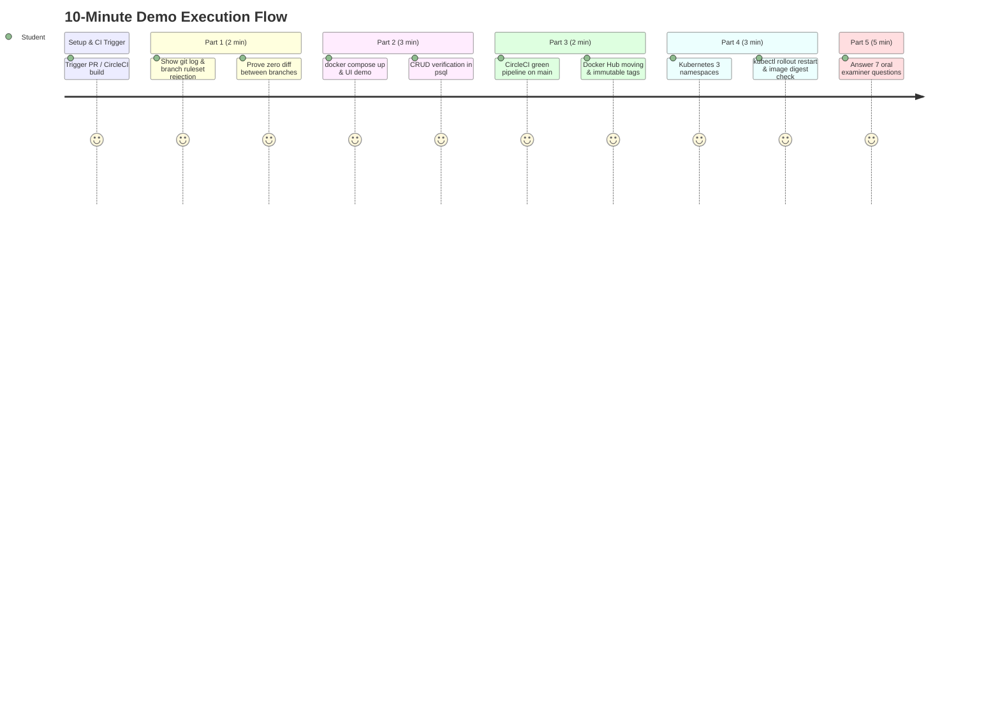

# Food Delivery Order Tracker — Capstone Demo & Pipeline Runbook

> **Assessment:** 3rd Year ISE · Individual Submission · **80 Marks Total**  
> **Target:** Full score across Git Promotion (15m), Docker/Compose (15m), CircleCI (20m), Kubernetes (20m), and Questions (10m).

---

## 📋 Pre-Demo Setup & Submission Checklist

Before entering your demo slot, submit all three public links:
1. **Fork's GitHub URL:** `https://github.com/kathyayinidayanand2006-ux/delivery-tracker-python`
2. **Docker Hub Repository URL:** `https://hub.docker.com/r/kathyayinidayanand2006/delivery-tracker-python`
3. **CircleCI Project URL:** `https://app.circleci.com/pipelines/github/kathyayinidayanand2006-ux/delivery-tracker-python`

Make sure all 3 tabs are open in your browser, your local Docker daemon is running, and minikube is active.

---

## ⏱️ 10-Minute Demo Slot Walkthrough (Minute-by-Minute)



---

### Step 0: Kick Off the Pipeline First (Minute 0)
> **PDF Instruction (Page 5):** *"Start your CircleCI pipeline at the beginning of your slot, not when you reach step 3. A full run takes several minutes; if you trigger it at minute seven you will be watching a spinner while your time runs out. Merge the PR first, talk through Git and Compose while it builds, and come back to a green pipeline."*

1. Open your browser on the GitHub pull requests tab.
2. Merge the pending promotion PR into `main` (or trigger the pipeline).
3. Switch immediately to terminal for **Part 1**.

---

### Part 1: Git & Branch Promotion (15 Marks — 2 Minutes)

#### 1. Show Clean Commit History & Single-Direction Promotion
```bash
git log --oneline --graph --all
```
**Explain to the evaluator:**
- Real feature development was done on feature branches (e.g., adding `DELETE /orders/{id}` endpoint and interactive operational UI with concurrency safeguards).
- Promotion flow is strictly **one-way**:
  $$\text{feature branch} \longrightarrow \text{main (QA)} \longrightarrow \text{staging} \longrightarrow \text{prod}$$
- Promotion PRs are always merged with **"Create a merge commit"** (never "Squash and merge") so commit SHAs and history remain intact across branches without identity conflicts.

#### 2. Prove Direct Push is Blocked by Branch Ruleset
```bash
git checkout main
git commit --allow-empty -m "testing direct push"
git push origin main
```
*Expected Result:* **Push rejected by GitHub** with a rule violation error (`GH013: Repository rule violations found`).  
Clean up afterwards:
```bash
git reset --hard origin/main
```

#### 3. Prove Zero Branch Inconsistencies
```bash
git diff main staging
git diff staging prod
```
*Expected Result:* **Completely empty output**! Both branches match exactly after promotion.

---

### Part 2: Dockerfile & Docker Compose (15 Marks — 3 Minutes)

#### 1. Highlight Dockerfile Security & Best Practices
Open [`Dockerfile`](Dockerfile) and explain:
- **Base image:** Pinned to `python:3.12.12-slim-bookworm`.
- **Non-root user:** Runs as `appuser` (UID 10001) instead of `root`.
- **Layer caching:** `COPY requirements.txt .` before copying application code.
- **Port:** Correct `EXPOSE 8080`.
- **Start command:** `CMD ["uvicorn", "app.main:app", "--host", "0.0.0.0", "--port", "8080"]`.
- **No baked credentials:** No `.env` or credentials in the image; complete [`.dockerignore`](.dockerignore) is present.

#### 2. Launch Stack with Docker Compose
```bash
docker compose up -d
```
Explain:
- **Automatic database migrations:** The `migrate` service runs `python -m app.migrate` against Postgres before the application starts.
- **Healthy dependency orchestration:** `depends_on` with `condition: service_healthy` guarantees Postgres and Redis are fully operational before the app starts.
- **Clean start:** Clone the fork, run `docker compose up`, and the application works immediately with zero manual configuration.

#### 3. Interactive Web UI Demonstration
Open your browser at `http://localhost:8080/`:
- **Real-time health:** Show Postgres and Redis green indicators.
- **Place an order:** Enter customer name, choose a dish (e.g. Butter Chicken), and click **"Place Delivery Order"**.
- **State Machine Progression:**
  - Click **"✓ Accept Order"** $\rightarrow$ status moves to `accepted` (version bumped).
  - Click **"🍳 Start Cooking"** $\rightarrow$ status moves to `cooking`. Notice that **"Cancel"** is now disabled!
  - Click **"🛵 Out for Delivery"** $\rightarrow$ progress moves to 75%.
  - Click **"🎉 Mark Delivered"** $\rightarrow$ terminal state reached (100% progress).
- **Safe Delete (Terminal Order):** Click **"🗑 Delete (CRUD)"** $\rightarrow$ order is deleted and cache is dropped.

#### 4. API CRUD & PostgreSQL Physical Persistence Demonstration
Run in PowerShell / bash:

```bash
# 1. CREATE (POST)
curl -X POST http://localhost:8080/orders \
  -H "Content-Type: application/json" \
  -d '{"customer":"Demo User","restaurant":"Spice Garden","items":[{"name":"Chicken Tikka","paise":28000}]}'

# Note the returned ID (e.g. 1)

# 2. READ (GET)
curl http://localhost:8080/orders/1

# 3. VERIFY PERSISTENCE IN POSTGRESQL (psql)
docker compose exec db psql -U tracker -d tracker -c "SELECT id, customer, status, total_paise FROM orders WHERE id=1;"

# 4. UPDATE STATUS (POST)
curl -X POST http://localhost:8080/orders/1/status \
  -H "Content-Type: application/json" \
  -d '{"to":"accepted","actor":"Kitchen"}'

# 5. DELETE TERMINAL ORDER (DELETE)
# First advance to delivered or cancelled, then:
curl -X POST http://localhost:8080/orders/1/cancel -H "Content-Type: application/json" -d '{"actor":"Customer"}'
curl -X DELETE http://localhost:8080/orders/1
```

---

### Part 3: CircleCI CI/CD Pipeline (20 Marks — 2 Minutes)

#### 1. Show the Full Pipeline on `main` (QA)
Open CircleCI web dashboard. Show that on `main`, all steps are **green**:
1. **`secret-scan`:** Scans repository commits for leaked keys using `gitleaks`.
2. **`lint`:** Python code style and PEP enforcement with `ruff check app tests`.
3. **`unit-tests`:** Runs unit tests testing pure state machine logic (`test_states.py` & `test_api.py`).
4. **`integration-tests`:** Runs integration tests against **real Postgres 16 and Redis 7 service containers** on `localhost`, measuring test coverage (>70%).
5. **`publish-qa`:** Builds image with `setup_remote_docker` and pushes to Docker Hub.

#### 2. Show Build-Only Pipeline on `staging` & `prod`
Show that `staging` and `prod` branches trigger **build-only** workflows (`publish-stage` and `publish-prod`) with **zero test stages**.

#### 3. Show Dual Tagging on Docker Hub
Open `https://hub.docker.com/r/kathyayinidayanand2006/delivery-tracker-python/tags`:
Point out the two tags pushed on each build:
- **Moving tag:** `:qa` / `:stage` / `:prod` (what Kubernetes tracks)
- **Immutable tag:** `:<branch>-<short-sha>` (e.g. `main-0ee7d9e` — how we prove at the demo which commit is running).

---

### Part 4: Kubernetes Across 3 Namespaces (20 Marks — 3 Minutes)

#### 1. Deploy / Show 3 Active Namespaces
```bash
# Setup namespaces, secrets, and apply workloads
.\k8s\setup-k8s.ps1 -DockerUser "kathyayinidayanand2006" -DockerToken "<token>"

# Inspect resources across namespaces:
kubectl get namespaces
kubectl get pods -n qa
kubectl get pods -n stage
kubectl get pods -n prod
```

#### 2. Inspect Pull Secrets and moving tags
```bash
kubectl get secret dockerhub -n qa
kubectl get pods -n qa -o jsonpath='{range .items[*]}{.spec.containers[*].image}{"\n"}{end}'
```
- `qa` pulls `delivery-tracker-python:qa`
- `stage` pulls `delivery-tracker-python:stage`
- `prod` pulls `delivery-tracker-python:prod`
- `imagePullPolicy: Always` ensures new builds are pulled rather than relying on stale cached images.

#### 3. Demonstrate the Continuous Deployment Loop
```bash
# Trigger rolling restart
kubectl rollout restart deployment/delivery-tracker -n qa

# Wait for rollout completion
kubectl rollout status deployment/delivery-tracker -n qa

# Prove the exact Image ID digest
$pod = (kubectl get pods -n qa -l app=delivery-tracker -o jsonpath='{.items[0].metadata.name}')
kubectl describe pod $pod -n qa | Select-String "Image ID"
```
Show that the **Image ID digest** reported by Kubernetes matches the exact digest pushed by the CircleCI build.

---

## 🎯 Part 5: Oral Examination / Viva Answers (10 Marks — 5 Minutes)

Here are the exact answers to the 7 evaluation questions specified on page 5 of the PDF:

### Q1: "Why is this a Deployment and not a Pod?"
> **Answer:** A Pod is an ephemeral, standalone container instance with no self-healing or lifecycle management. If a Pod crashes or the underlying worker node fails, it is permanently lost. A Deployment manages a ReplicaSet, ensuring the desired number of replicas are always running, handles zero-downtime rolling updates (`rollout restart`), supports rollback to previous revisions, and automatically heals unhealthy containers.

### Q2: "Your integration test talks to `localhost` on CircleCI but to `db` in Compose. Why are those different?"
> **Answer:** In Docker Compose, each service runs in its own isolated container network namespace; containers discover each other through Docker's internal DNS resolver using their container service names (`db`, `redis`). In CircleCI, secondary service containers share the primary executor container's network namespace (the Linux loopback interface), which means PostgreSQL and Redis listen directly on `localhost:5432` and `localhost:6379`.

### Q3: "What happens if I delete one of your Pods right now?"
> **Answer:** The Kubernetes Deployment controller continuously monitors the cluster state through its reconciliation control loop. When a Pod is deleted, current replicas (0) no longer matches desired replicas (1). The ReplicaSet controller immediately provisions a brand new Pod to restore the desired state.

### Q4: "Why does your Dockerfile create a user instead of running as root?"
> **Answer:** Principle of Least Privilege and defense-in-depth security. If an application running as `root` (UID 0) suffers a container escape or remote code execution vulnerability, the attacker inherits root privileges over the host kernel and filesystem. Creating a dedicated non-root user (`appuser` with UID 10001) restricts the process execution to an unprivileged user space.

### Q5: "Your Service says Running but the page does not load. Where do you look first?"
> **Answer:** First check the Service endpoints with `kubectl get endpoints <service-name> -n <namespace>`. If the `ENDPOINTS` column is `<none>`, the Service's `spec.selector` labels do not match the Pod's `metadata.labels`. Second, verify port mapping (`port` vs `targetPort`). Third, check container logs with `kubectl logs <pod-name> -n <namespace>` and pod readiness probe statuses with `kubectl describe pod <pod-name> -n <namespace>`.

### Q6: "Why `:qa` and `:stage` rather than one `:latest` tag for everything?"
> **Answer:** Environment isolation and promotion safety. Using `:latest` across environments creates a race condition where testing in QA and staging is bypassed, causing production to accidentally pull untested changes. Separate moving tags (`:qa`, `:stage`, `:prod`) allow each environment to track its own lifecycle gate, while immutable tags (`:<branch>-<short-sha>`) provide cryptographic auditability of which exact commit is running in each environment.

### Q7: "What exactly does `rollout restart` do — does it rebuild anything?"
> **Answer:** It does **not** rebuild anything. `kubectl rollout restart` updates the pod template metadata annotation (injecting a `kubectl.kubernetes.io/restartedAt` timestamp). This triggers a standard Kubernetes rolling update: new Pods are scheduled, pull the image from Docker Hub (because `imagePullPolicy: Always` is set), and terminate the old Pods once readiness probes pass.

---

## ⚠️ Traps That Have Caught People (PDF Page 6 Review)

1. **Port Mapping is outside:inside:** `"8080:8080"` maps laptop port 8080 to container port 8080.
2. **CircleCI Service Containers on localhost:** Integration tests use `localhost:5432` and `localhost:6379` in `.circleci/config.yml`.
3. **`setup_remote_docker` in CircleCI:** Present in the `publish-image` job so docker commands communicate with an active Docker daemon.
4. **Service selector matching Pod labels:** In `app.yaml`, Service selector is `app: delivery-tracker` matching Deployment `matchLabels: app: delivery-tracker`.
5. **No committed credentials:** All credentials exist exclusively in CircleCI environment variables (`DOCKERHUB_USER`, `DOCKERHUB_TOKEN`) and Kubernetes Secrets (`dockerhub`, `tracker-db`).
